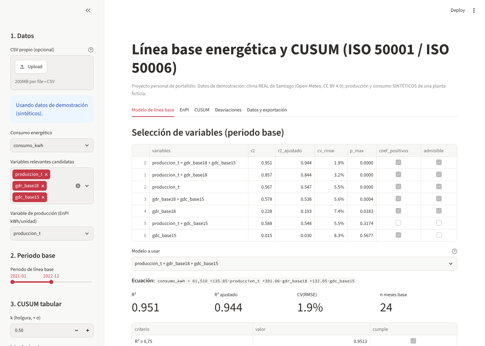
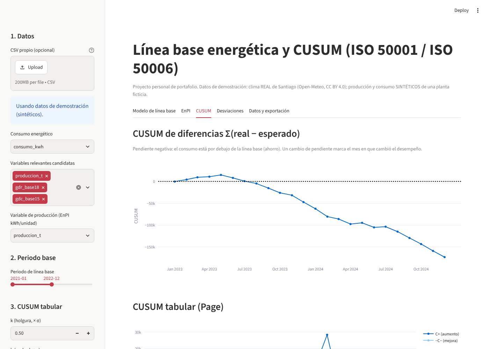

# Línea base energética ISO 50001 con CUSUM

[](https://linea-base-iso50001.streamlit.app)

**App en línea: https://linea-base-iso50001.streamlit.app** (si está dormida, pulsa el botón para despertarla; tarda unos 30 s).

App en Streamlit que construye la **línea base energética** de una planta por regresión (consumo vs
producción y grados día), calcula los **EnPI** según ISO 50001 / ISO 50006, cuantifica el **ahorro
normalizado** y detecta **cambios de desempeño** con CUSUM.

> **Proyecto personal de portafolio.** El clima es real (Santiago, Open-Meteo); la producción, el
> consumo y los eventos son **sintéticos** y no corresponden a ninguna planta real.
> Desarrollado con **[Claude Code](https://claude.com/claude-code)**: yo definí y validé el modelo
> (ver [MODELO.md](MODELO.md)); Claude Code escribió el código, los tests y la interfaz.



## Qué hace

1. **Selecciona variables relevantes**: prueba todas las combinaciones y acepta solo modelos con
   p < 0,05 y coeficientes físicamente coherentes (positivos).
2. **Valida la línea base**: R², CV(RMSE), NMBE (ASHRAE G14), p-valores y Durbin-Watson.
3. **EnPI**: normalizado (real/esperado) y de cociente simple (kWh/t), para mostrar por qué el segundo engaña.
4. **CUSUM** de diferencias y **CUSUM tabular de Page** con recentrado tras cada alarma.
5. **Desviaciones**: meses fuera del intervalo de predicción 95 % y alarmas del CUSUM.
6. **Valoriza en pesos** el ahorro y las pérdidas detectadas (precio editable; por defecto, el Precio
   Medio de Mercado de la CNE, que es un mínimo conservador).
7. **Exporta a Excel** resultados, selección de modelo, validación y coeficientes.
8. Acepta un **CSV propio**: descarga la plantilla desde la barra lateral, reemplaza las filas con los
   datos de tu planta (mínimo 12 meses de periodo base) y súbela.

## Por qué importa en Chile

La [Ley 21.305](https://www.bcn.cl/leychile/navegar?idNorma=1155887) obliga a las empresas que consumen
más de 50 Tcal/año (≈ 58 GWh) a implementar un sistema de gestión de energía con indicadores de
desempeño y medición y verificación. Esta app hace ese núcleo: línea base, EnPI y seguimiento.
La planta de demostración es mucho más chica que ese umbral.



## Validación

Como los datos son sintéticos, se sabe qué debía encontrar el modelo:

| Prueba | Resultado |
|---|---|
| Variables recomendadas | Producción + GDR + GDC (las tres verdaderas); R² 0,951; CV(RMSE) 1,9 % |
| Cobertura IC95 de coeficientes (300 réplicas Monte Carlo) | 90–99 % |
| Ahorro 2023–2024 | Estimado 173 MWh vs verdadero 161 MWh |
| Mejora sembrada (VDF en chillers, desde 2023-07) | Detectada en 2023-09 |
| Fuga de aire comprimido (2024-05 a 07) | Detectada en 2024-05, sin falsas alarmas previas, aunque ese mes quedó dentro del intervalo de predicción |
| Costo estimado de la fuga | 30 MWh ≈ 2,9 millones CLP (verdadero: 42 MWh) |

Detalle, supuestos y limitaciones en [MODELO.md](MODELO.md).

## Uso

```bash
python -m venv .venv && source .venv/bin/activate
pip install -r requirements.txt
streamlit run app.py
pytest -q          # 13 tests
python scripts/generar_datos_sinteticos.py   # regenera los datos de demostración
```

## Estructura

```
app.py                         Interfaz Streamlit
src/lb50001/modelo.py          Regresión, validación, EnPI, CUSUM
scripts/generar_datos_sinteticos.py
data/clima_santiago_mensual.csv   Grados día reales (Open-Meteo)
data/planta_sintetica.csv         Datos sintéticos de demostración
tests/                         pytest
MODELO.md  SOURCES.md
```

## Licencia

Código MIT. Datos climáticos: Open-Meteo, CC BY 4.0 (ver [SOURCES.md](SOURCES.md)).
